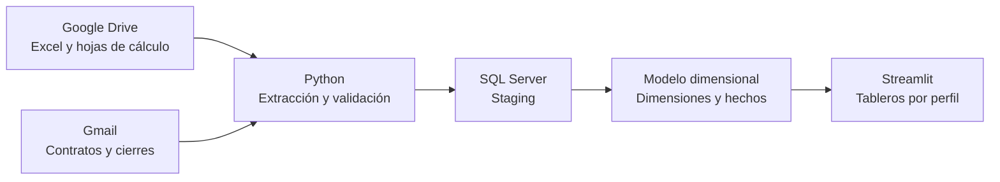

# MAAS Ecología | Integración de Datos y Business Intelligence

**Proyecto de tesis — Ingeniería en Información y Control de Gestión**  
**Universidad Católica del Norte · 2026**

**Integrantes:** Giuliana Albasini, Allyson Gallardo y Yerica Quinceno.

## Descripción del proyecto

Este repositorio contiene el desarrollo de un **modelo de integración de datos de Business Intelligence para apoyar la gestión operativa y la toma de decisiones en MAAS Ecología**.

La solución integra información de distintas fuentes de trabajo, aplica procesos de **extracción, transformación y carga (ETL)** mediante Python, organiza los datos en **Microsoft SQL Server** y los presenta en **tableros interactivos desarrollados con Streamlit**, con vistas diferenciadas por perfil organizacional.

> **Contexto académico:** se incluyen archivos de ejemplo con datos simulados. El código fue desarrollado para un entorno local y requiere configurar credenciales, accesos y conexiones antes de ejecutarse en otro equipo. Este repositorio **no es una aplicación web desplegada**.

## Objetivo

Diseñar e implementar una solución de integración de datos que permita consolidar información procedente de diversas fuentes, mejorar su trazabilidad y facilitar el seguimiento de indicadores relevantes para la gestión de MAAS Ecología.

### Componentes principales

- **Extracción:** recuperación de archivos desde Google Drive y mensajes seleccionados de Gmail mediante sus API.
- **Transformación y validación:** normalización, controles de calidad y verificación de consistencia de los registros.
- **Almacenamiento:** carga de datos en SQL Server, con tablas de *staging*, dimensiones y hechos para el análisis.
- **Visualización:** indicadores, filtros y tablas interactivas en Streamlit, organizados según el perfil de acceso.
- **Actualización:** scripts para ejecutar y programar el flujo ETL.

## Arquitectura general



## Tecnologías utilizadas

| Tecnología | Aplicación en el proyecto |
| --- | --- |
| **Python** | Desarrollo y automatización del ETL |
| **Google Drive API / Gmail API** | Extracción de fuentes autorizadas |
| **Pandas** | Tratamiento y validación de información |
| **Microsoft SQL Server** | Persistencia y modelo analítico |
| **PyODBC** | Conexión entre Python y SQL Server |
| **Streamlit** | Aplicación de visualización interactiva |
| **Plotly** | Gráficos de indicadores |
| **Git y GitHub** | Versionamiento y colaboración |

## Estructura del repositorio

```text
MAAS-Ecologia-BI/
├── ETL_Drive_MAAS_paso_01/
│   ├── 01_extraer_desde_drive.py
│   ├── 01_extraer_desde_gmail.py
│   ├── 02_transformar_y_validar.py
│   ├── 03_probar_conexion_sql.py
│   ├── 04_cargar_staging.py
│   ├── 05_cargar_dimensiones.py
│   ├── 06_verificar_y_cargar_hechos.py
│   ├── 08_ejecutar_etl_maas.py
│   ├── 09_programar_etl_maas.py
│   ├── requirements.txt
│   └── ... otros scripts de apoyo
├── MAAS_STREAMLIT_V09_SEMAFOROS_ACCESOS/
│   ├── app_maas_4.py
│   ├── pages_v08/
│   │   ├── inicio.py
│   │   ├── gerencia.py
│   │   ├── administracion.py
│   │   ├── ingenieria.py
│   │   ├── operaciones.py
│   │   ├── proyectos.py
│   │   ├── contratos.py
│   │   └── ventas.py
│   ├── requirements_streamlit.txt
│   └── ... módulos de acceso, datos y exportación
├── fuentes_drive/
│   ├── bsc/
│   ├── ventas/
│   ├── caja/
│   └── proyectos/
├── MAAS_ECOLOGIA_4_estructura.sql
├── .gitignore
└── README.md
```

## Fuentes de información

La carpeta `fuentes_drive/` contiene ejemplos autorizados para fines académicos:

- **BSC:** indicadores de gestión.
- **Ventas:** documentación y registros de facturación.
- **Caja:** seguimiento mensual.
- **Proyectos:** archivos de seguimiento, tareas y programación.

Actualmente, el repositorio contiene **3 archivos principales y 19 archivos en la carpeta de proyectos**. La cantidad de archivos incluidos no necesariamente coincide con el número de proyectos cargados en el modelo analítico durante una ejecución particular.

La extracción automatizada consulta Google Drive y Gmail mediante una configuración OAuth independiente de estas copias de ejemplo.

## Tableros de control

La aplicación incluye las siguientes vistas:

| Vista | Enfoque |
| --- | --- |
| Inicio | Acceso al portal de indicadores |
| Gerencia General | Visión consolidada del desempeño |
| Administración | Seguimiento de indicadores administrativos |
| Ingeniería | Indicadores asociados al área de ingeniería |
| Operaciones | Seguimiento de la gestión operativa |
| Proyectos | Estado y avance de proyectos |
| Contratos | Seguimiento de información contractual |
| Ventas | Análisis e indicadores comerciales |

El acceso por perfil implementado en esta versión es **de demostración local**; no sustituye los mecanismos de seguridad requeridos para un despliegue empresarial o público.

## Requisitos para ejecutar el proyecto

- **Windows** con **Python** instalado (el iniciador `.bat` fue configurado originalmente para Python 3.12).
- **SQL Server** compatible con el esquema exportado y **ODBC Driver 17 o 18 for SQL Server**.
- Acceso autorizado a las **API de Google Drive y Gmail**, si se desea realizar la extracción desde la nube.
- Permisos y configuración de conexión a la base `MAAS_ECOLOGIA_4`.

### 1. Obtener el código

```powershell
git clone https://github.com/GiuliAlbasini/MAAS-Ecologia-BI.git
cd MAAS-Ecologia-BI
```

### 2. Preparar el entorno ETL

```powershell
cd ETL_Drive_MAAS_paso_01
py -m pip install -r requirements.txt
```

Para autenticación con Google, crear una carpeta local `config/` y configurar un cliente OAuth de escritorio autorizado según las instrucciones de `INSTRUCCIONES.txt`:

```text
ETL_Drive_MAAS_paso_01/config/
├── credentials.json       # Credencial OAuth privada
├── token_drive.json       # Se genera tras autorizar Drive
└── token_gmail_maas.json  # Se genera tras autorizar Gmail
```

**Nunca subir estos archivos a GitHub.** Los tokens se generan localmente al autorizar cada servicio.

### 3. Preparar SQL Server

El repositorio incluye `MAAS_ECOLOGIA_4_estructura.sql`, exportado en modalidad **solo esquema**; no contiene una copia completa de la base de datos en funcionamiento.

**Advertencia:** el script incluye parámetros y rutas de almacenamiento correspondientes al servidor donde fue generado. Debe **revisarse y adaptarse antes de ejecutarse** en otro SQL Server. No ejecutar sobre una base existente sin respaldo y revisión técnica.

### 4. Ejecutar el proceso ETL

Desde `ETL_Drive_MAAS_paso_01/`:

```powershell
# Validación y prueba sin cargar cambios en SQL Server
py .\08_ejecutar_etl_maas.py --probar

# Ejecución con actualización de la base, solo cuando la configuración esté verificada
py .\08_ejecutar_etl_maas.py --ejecutar
```

La ejecución completa depende de las credenciales OAuth, los archivos disponibles y la conexión SQL Server configurados en el equipo.

### 5. Iniciar los tableros

Desde la raíz del repositorio:

```powershell
cd MAAS_STREAMLIT_V09_SEMAFOROS_ACCESOS
py -m pip install -r requirements_streamlit.txt
py -m streamlit run .\app_maas_4.py
```

Streamlit consulta `MAAS_ECOLOGIA_4`; **no se conecta directamente a los Excel de ejemplo** para construir todos los indicadores. Sin una base de datos configurada, el código puede abrir parcialmente, pero las vistas dependientes de SQL no tendrán resultados.

## Seguridad y consideraciones de uso

- El repositorio se comparte con fines **académicos y de demostración**.
- Las credenciales OAuth, tokens, archivos `.env` y claves reales deben mantenerse fuera del control de versiones.
- Las claves de demostración presentes en versiones locales **no deben reutilizarse para proteger datos reales**.
- Las rutas absolutas y parámetros específicos del equipo original deben adaptarse para otras instalaciones.
- Antes de utilizar la solución en producción se requiere revisar la autenticación, los permisos de SQL Server, la protección de secretos, las políticas de acceso y el despliegue.

## Alcance del repositorio

Este repositorio documenta el **desarrollo académico y su implementación local**. Incluye scripts, estructura de base de datos y archivos de entrada simulados, pero **no garantiza una ejecución inmediata sin configuración** y **no publica un servicio Streamlit en línea**.

## Equipo de desarrollo

**Proyecto de título — Universidad Católica del Norte**  
Ingeniería en Información y Control de Gestión

- Giuliana Albasini
- Allyson Gallardo
- Yerica Quinceno

---

*MAAS Ecología · Proyecto de Business Intelligence · 2026*
